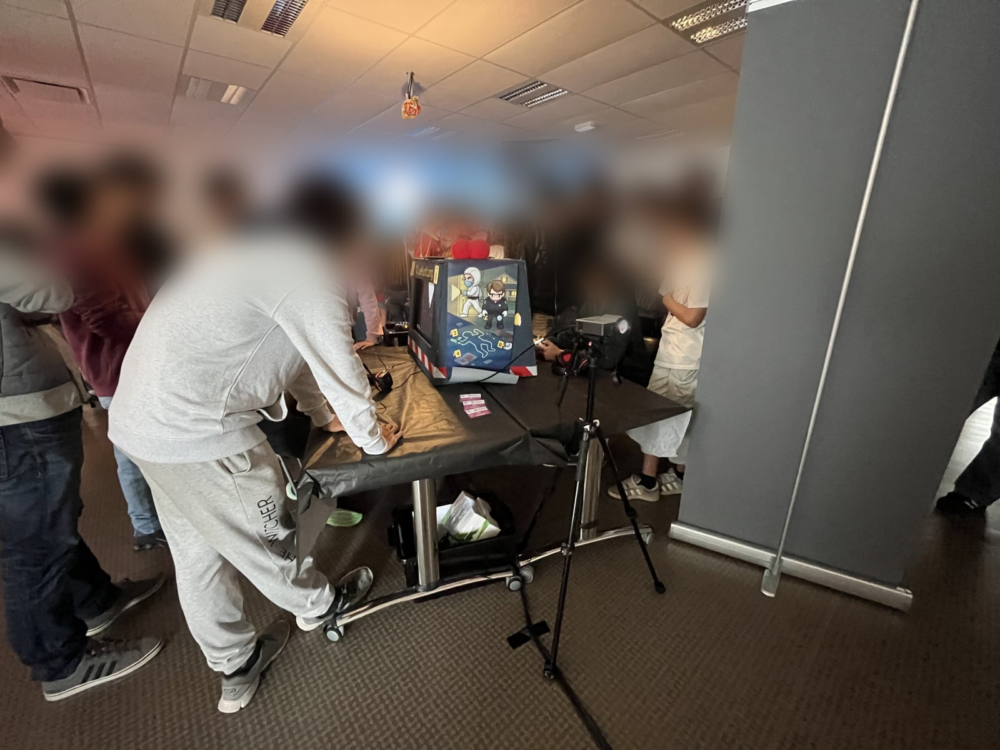
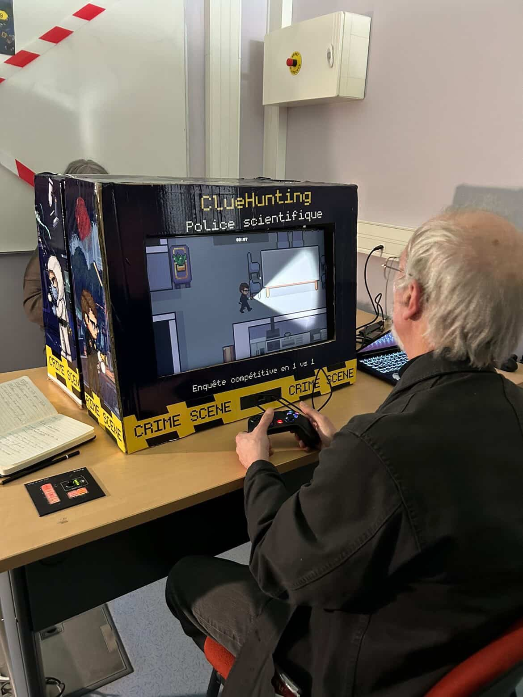

# Clue Hunting — Crime & Science

**A competitive 1 vs 1 forensic investigation game made with Unity, played by around 200 visitors at the [Journées du Crime et de la Science](https://www.crimeetscience.com/) 2026.**
Two forensic agents race against the clock to solve a criminal case: one works the crime scene, the other analyses evidence in the lab.

---

## Played at the festival

- **Event:** [Journées du Crime et de la Science](https://www.crimeetscience.com/), 29–31 May 2026, Pôle Phoenix, Pleumeur-Bodou (France). A public festival on forensic science with over 50 experts from the police, justice and research.
- **Context:** part of the festival's interactive games area on disappearances and cold cases, created by BUT MMI students from IUT de Lannion.
- **Players:** around 200 visitors over 3 days, from high-school groups to adults.
- **Setup:** a custom cardboard arcade cabinet with two controllers, plus a live leaderboard projected in the room.

### My role

The concept and the artwork were a group effort, and I did most of it. Specifically:

- **All of the code**: the whole Unity / C# game was programmed by me.
- **Game design**: user flow, storyline and world building.
- **Sound design.**
- **Engagement system**: player nicknames and a live, projected leaderboard that kept visitors coming back to beat the top score.

  

Building for a public event meant designing for people who had never seen the game: an in-game tutorial led by the police chief character, a virtual keyboard for entering player names with a controller, short timed rounds, and a public leaderboard to keep the crowd engaged between games.

---

## Highlights

- **Competitive two-player design**: a field investigator and a lab analyst, each with their own view, competing for the best score.
- **Three-display setup**: Unity multi-display with one camera per player and a dedicated leaderboard screen, with graceful fallback on one or two screens.
- **Replayability**: clue and interaction-point positions are randomised each game.
- **Solo mode**: one player picks a role and the camera is redirected to the main display.
- **Built for walk-up players**: tutorial system, controller-friendly menus, timer, persistent scoreboard.

---

## Tech stack

| Area | Technology |
|---|---|
| Engine | Unity 6 (6000.0.59f2), Universal Render Pipeline (2D) |
| Language | C# |
| Input | Unity Input System (Xbox / PlayStation controllers) |
| Art | Pixel-art top-down tilesets, custom sprite sheets, Cartoon FX particles |

Main gameplay scripts are in [`Assets/Scripts/`](Assets/Scripts) (lobby, player movement, interactions, hint randomisation, timer, scoring, solo mode, scene transitions).

---

## Play it

### Requirements

- Windows 10 or later
- 2 controllers (Xbox, PlayStation or compatible)
- 3 screens recommended (the game also runs on one or two)

### Install

1. Download **ClueHunting.rar** from the root of this repository.
2. Extract it anywhere.
3. Run **CrimeEtScienceGame.exe**.

### Screens

| Screen | Shows |
|---|---|
| 1 | Player 1 view |
| 2 | Player 2 view |
| 3 | Live leaderboard and scores |

### How to play

1. Connect two controllers before launching the game.
2. In the main menu, each player enters a name with the virtual keyboard.
3. Follow the police chief's tutorial.
4. Explore the crime scene, photograph clues and analyse evidence before time runs out.
5. The player with the highest score wins.

The game's text is in French.

---

## Open the project in Unity

Open the repository folder with **Unity 6000.0.59f2** (Unity Hub → Add project from disk).
